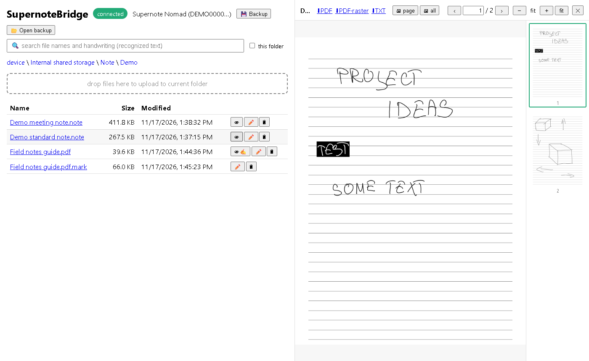
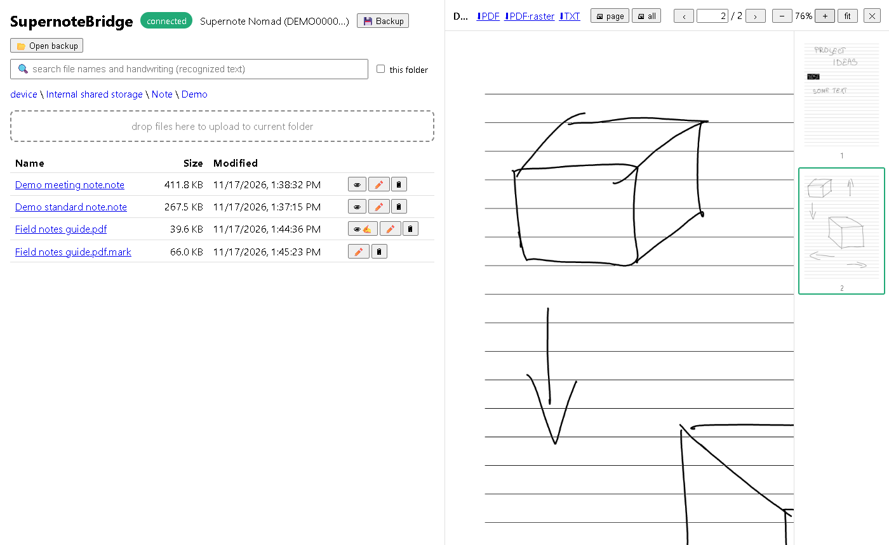
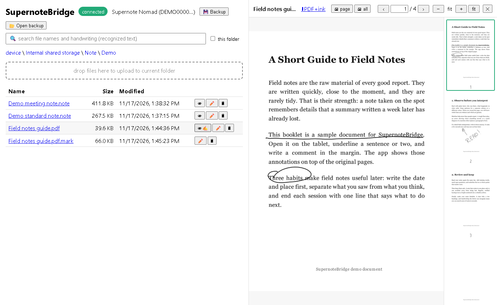
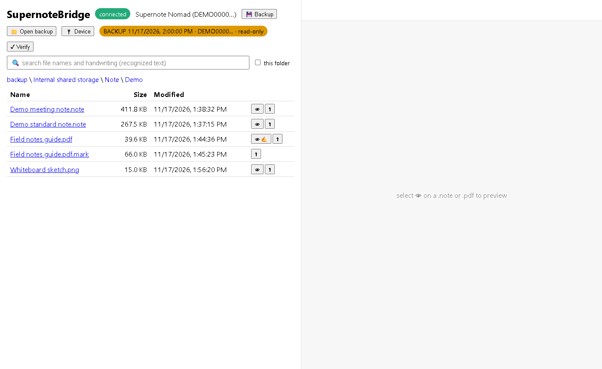
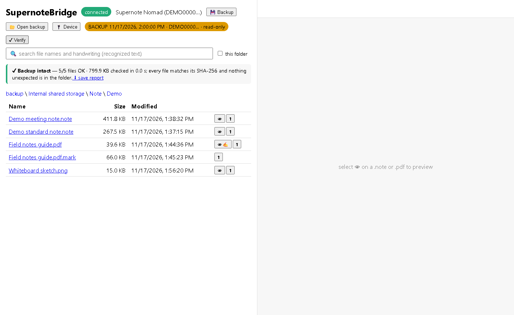
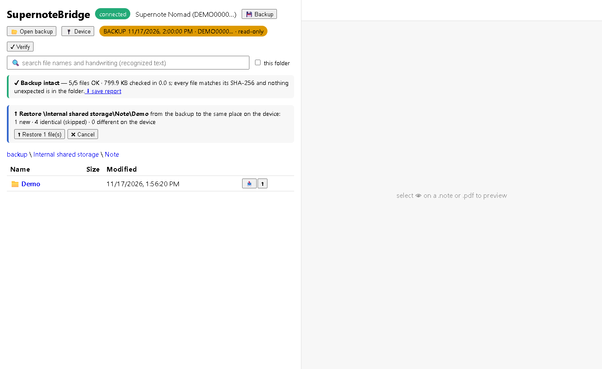
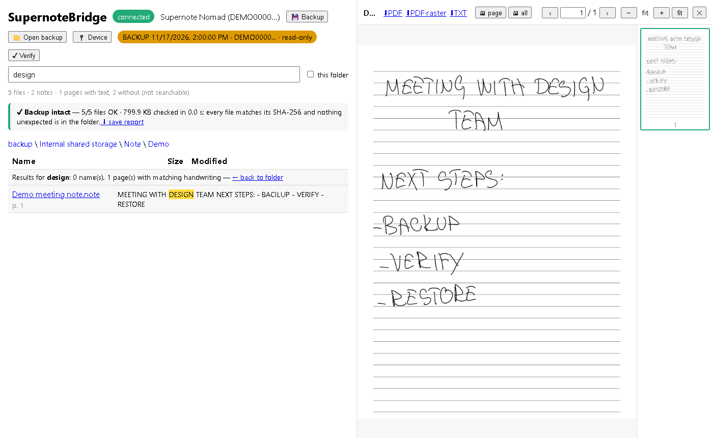

# SupernoteBridge

A portable, offline Windows companion app for the **Supernote** e-ink tablet (tested on the A6X2 Nomad).
Connect the tablet over USB, run one `.exe`, and manage it from your browser: browse and transfer files,
preview handwritten notes, export to PDF/TXT, print, back up the whole device, verify and restore backups,
and search your recognized handwriting. No installer, no account, no cloud, no internet.



## Download

1. Download `SupernoteBridge.exe` from the [latest release](https://github.com/dagvelovic/supernote-bridge/releases/latest).
2. Put it in any folder (a USB stick works too) and run it. Nothing is installed and no admin rights are needed.
3. Connect the Supernote with a USB cable and unlock it. The app opens `http://127.0.0.1:8099` in your browser.

Windows SmartScreen may warn about an unknown publisher the first time, because the exe isn't code-signed.
Choose **More info → Run anyway**, or build it yourself from source (see [Build from source](#build-from-source)).

## Why

Supernote tablets connect over USB as an MTP device (no drive letter), and the official tools lean on the
cloud. The goal was a local tool that keeps notes on your own machine: full, verifiable backups, a quick way to
read and export notes, and no device content left behind on disk except what you explicitly save.

## Using SupernoteBridge

The screenshots below use demo notes; the device serial number is masked.

### 1. Browse the device and preview notes

The left pane is the device's file system. Click a folder to open it; the path above the list takes you back.
Each file row has buttons:

1. **👁 preview** a `.note`, PDF or image in the right pane.
2. **✏️ rename** and **🗑 delete**.
3. **📤** on a folder exports every note in it to PDF.

Drag files onto the dashed area to upload them to the current folder. An existing file is replaced safely:
the new copy is uploaded under a temporary name, its size is checked, and only then the old file is swapped out.
Click a file name to download it.

The preview shows page thumbnails (minimap) on the right, a page number box, and zoom buttons
(**−**, **+**, **fit**). Previews are rendered in memory and never written to disk.



### 2. Annotated PDFs

When you write on a PDF on the Supernote, the device stores your ink in a separate `.pdf.mark` file.
SupernoteBridge shows such PDFs with the ink on top (**👁✍** button) and can export them as **PDF+ink**.



### 3. Export and print

Links above the preview export the open document:

1. **⬇PDF:** vector PDF (default; sharp at any zoom).
2. **⬇PDF-raster:** page images in a PDF.
3. **⬇TXT:** the text the device recognized from your handwriting.
4. **⬇PDF+ink:** an annotated PDF with your ink burned in.

**🖨 page** and **🖨 all** print the current page or the whole document through the browser's print dialog,
where you pick the printer, paper and orientation.

### 4. Back up the device

**💾 Backup** asks for a folder and copies the whole device into a new
`YYYYMMDD-HHMMSS_SUPERNOTE_BACKUP` folder. Every backup is a full, independent copy, not an increment.
A `manifest.json` records each file's path, size, date and SHA-256 checksum.
Backups can also be made from the command line or by Task Scheduler (see [Command line](#command-line)).

### 5. Open a backup without the device (offline mode)

**📂 Open backup** asks for the `manifest.json` inside a backup folder. The app then shows the backup instead
of the device: browse, preview, print and export work as usual. The orange badge shows which backup is open,
and the backup is strictly read-only. **🔌 Device** switches back to the tablet.



### 6. Verify a backup

**✔ Verify** (visible while a backup is open) re-reads every file and compares it with the SHA-256 in the
manifest. It reports missing, damaged and unexpected files; **save report** downloads the result.
The same check runs headless with `--verify <dir>` (exit code 0 = intact, 1 = problems, 2 = not a backup).



### 7. Restore from a backup

With a backup open and the device connected, **⬆** on a file or folder restores it to the same place on the device.
The app first shows a plan: how many files are new, identical (skipped) or different on the device, and it
warns if the backup came from another device. For different files you choose **overwrite** or **skip**.
Each restored file is uploaded under a temporary name, read back and checked against its SHA-256, and only then
swapped in. A PDF brings its `.pdf.mark` along.



### 8. Search names and handwriting

Type in the search box to find files by name and notes by the text the Supernote recognized in your handwriting.
Matching ignores case and accents. **this folder** limits the search to the folder shown.
Clicking a result opens the note at the matching page. Search works on the device and on an open backup;
the index is built in memory each session and never saved.



Only pages the device has recognized are searchable: notes created with *Real-Time Recognition*, or pages
recognized on the device by exporting them to text.

## Features at a glance

1. **Device files:** browse, download, upload (drag and drop, safe replace), rename, delete.
2. **Previews:** `.note`, annotated PDFs (`.mark` overlay), plain PDFs and images, with minimap, zoom and page jump.
3. **Exports:** vector PDF (default), raster PDF, TXT, PDF with ink; bulk export of a folder to PDF.
4. **Print:** current page or whole document through the browser's print dialog.
5. **Backups:** full, independent copy of the device with a SHA-256 manifest.
6. **Offline mode:** open a backup and browse, preview, print and export it without the device (read-only).
7. **Verify:** re-hash a backup against its manifest, in the UI or headless.
8. **Restore:** dry-run plan first, then overwrite or skip changed files; every file is read back and SHA-256-checked.
9. **Search:** file names plus the device's recognized handwriting text; case- and accent-insensitive.
10. **CLI and REST API** for scripted and scheduled backups.

## Privacy and security

1. Everything runs on your PC. The web UI binds to `127.0.0.1` only; nothing goes to the internet or a cloud.
2. Device content never touches the disk except for explicit downloads, exports and backups.
3. Previews, uploads, restore checks and the search index live in RAM only.
4. Content endpoints send `Cache-Control: no-store`, so the browser doesn't cache your notes either.
5. Backups are never modified by the app; even exports into an open backup are refused.

## Requirements

1. Windows 10/11 x64.
2. A Supernote connected over USB (file transfer / MTP mode).
3. To run a release build: nothing else; the exe is self-contained.
4. To build: [.NET 8 SDK](https://dotnet.microsoft.com/download/dotnet/8.0).

## Command line

`settings.json` is read from the folder that holds the exe and created with defaults on first run.
See [`settings.example.json`](settings.example.json):

| Key | Meaning |
|---|---|
| `port` | UI port (default 8099) |
| `open` | open the browser on start |
| `backupRoot` | default backup parent folder; `null` = ask every time / `BACKUP` beside the exe |

Command-line switches override `settings.json`:

| Switch | Effect |
|---|---|
| `--port <n>` | UI port |
| `--open` / `--no-open` | open the browser on start, or not |
| `--backup <dir>` | back up the device into `<dir>` |
| `--quit` | with `--backup`: exit when the backup finishes |
| `--backup-on-attach` | back up automatically when the device is plugged in |
| `--open-backup <dir>` | start in offline mode with that backup open |
| `--verify <dir>` | verify a backup headless; exit code 0 / 1 / 2 |
| `--help` | show usage |

Scheduled backups: [`scripts/sn-backup.ps1`](scripts/sn-backup.ps1) wraps `--backup` with logging and exit codes for Task Scheduler.

## Build from source

```
git clone https://github.com/dagvelovic/supernote-bridge.git
cd supernote-bridge
dotnet build -c Release
dotnet test
dotnet run --project SupernoteBridge.Host -c Release
```

The browser opens `http://127.0.0.1:8099`.

Portable single-file exe:

```
dotnet publish SupernoteBridge.Host -c Release -r win-x64 --self-contained -p:PublishSingleFile=true -p:IncludeNativeLibrariesForSelfExtract=true -o publish
```

This produces `publish\SupernoteBridge.exe` (about 200 MB, includes the .NET runtime and the PDF engine).
Release builds strip local source paths and ship no PDB files (see `Directory.Build.props`).

## Documentation

1. [User manual](docs/SupernoteBridge_manual.md): every feature, the CLI, the REST API, troubleshooting.
2. [Design decisions](docs/decisions.md).
3. [`.note` metadata schema notes](SupernoteSharp/A5X_Metadata_Schema.md).

## Project layout

| Project | Purpose |
|---|---|
| `SupernoteBridge.Core` | device transport (WPD/MTP), backup-folder transport, services: render, export, backup, verify, restore, search |
| `SupernoteBridge.Host` | ASP.NET Core minimal API plus the single-page UI (`wwwroot/index.html`), embedded in the exe |
| `SupernoteBridge.Tests` | xUnit tests (in-memory device, temp folders; no device needed) |
| `SupernoteBridge.Spike` | developer diagnostics against a connected device |
| `SupernoteSharp` | vendored copy of [nelinory/SupernoteSharp](https://github.com/nelinory/SupernoteSharp), patched to parse from any `Stream` |

## Known limitations

1. Highlight-digest `.mark` files store strokes as vectors only and preview as blank pages.
2. MTP cannot set file dates, so restored files show the restore time on the device.
3. Only pages with device-recognized text are content-searchable; PDF/EPUB text is not indexed.
4. The app-private folder `Android\data` on the SD card cannot be read over MTP.

## Contributing

Bug reports and ideas are welcome in [Issues](https://github.com/dagvelovic/supernote-bridge/issues).
Pull requests are welcome too; please describe what you changed and how you tested it on a device.

## How it was built

This project was written entirely by **Claude Opus** (Anthropic) in Claude Code, guided by the
repository owner: the owner defined the need, set the requirements and the security policy, tested every
feature on a real device, and approved or rejected each design. The reasoning behind the design is kept in
[`docs/decisions.md`](docs/decisions.md).

## License

The SupernoteBridge code is released under the [MIT License](LICENSE).
Third-party components keep their own licenses; **release binaries include GPL and LGPL components**,
see [THIRD-PARTY-NOTICES.md](THIRD-PARTY-NOTICES.md).

Supernote is a trademark of Ratta. This project is not affiliated with or endorsed by Ratta.
